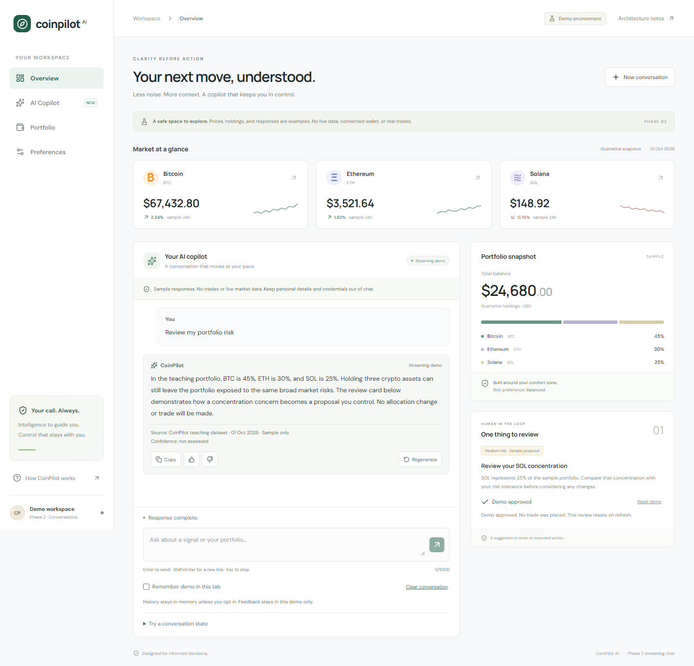

# CoinPilot AI — Phase 2

**Week 4: Streaming Chat UX and Conversational Interfaces**

A responsive conversational interface for the CoinPilot crypto copilot, continuing the [Module 1 product brief](https://github.com/PenielOkoli/coinpilot-ai) and [Phase 1 foundation](https://github.com/PenielOkoli/coinpilot-ai-phase-1). Phase 2 has its own repository and Vercel project.

## Submission

- Repository: https://github.com/PenielOkoli/coinpilot-ai-phase-2
- Live Vercel URL: https://coinpilot-ai-phase-2.vercel.app
- [Accessibility evidence and keyboard walkthrough](docs/accessibility.md)
- [Architecture and conversation lifecycle](docs/architecture.md)
- [Assessment evidence](docs/assessment.md)
- [Security checklist](docs/security-checklist.md)
- [Deployment](docs/deployment.md)

The submission intentionally uses a **streaming demo**, as requested. Responses are generated from a small teaching dataset on the server and sent progressively over a real Server-Sent Events connection. They are not Claude output or live market advice. No API key is required and no model bill is incurred.



## Try the interactions

1. Ask **Explain the BTC signal** and watch the answer grow as chunks arrive.
2. Select **Stop response**, or press Escape in the composer. Partial text remains labeled. **Retry response** asks for a fresh answer without duplicating the question.
3. After completion, **Regenerate** replaces the last answer with another demo phrasing. **Copy**, **Helpful**, and **Unhelpful** operate on that answer.
4. Ask **Why does that matter?** to see a bounded follow-up use the previous question.
5. Open **Try a conversation state**. Test a connection error before any text, a mid-response interruption, unavailable market data, or a safety fallback. Retry automatically selects normal streaming.
6. Enable **Remember demo in this tab**, then refresh. Messages and feedback return. Clear conversation removes the saved messages.

## Run and verify

Use Node.js 22.x.

```bash
npm ci
npm run dev
```

Open http://localhost:3000. If another app uses that port, run `npm run dev -- --port 3148`.

```bash
npm run check
npm run test:e2e
node scripts/verify-stream.mjs https://coinpilot-ai-phase-2.vercel.app
```

The browser suite starts its own production server on port 3148. Run `npm run build` first if running it independently. Windows uses installed Edge; on Linux, install Chromium with `npx playwright install --with-deps chromium`. Set `TEST_BASE_URL` to the deployed URL to exercise the live site. Optional screenshots use `CAPTURE_SCREENSHOTS=1`.

The optional workflow in `docs/ci-example.yml` can be moved to `.github/workflows/ci.yml` when GitHub authorization includes workflow permissions. Vercel is connected independently for deployment.

## Implementation

| File | Responsibility |
| --- | --- |
| `src/components/use-conversation.ts` | AI SDK `useChat`, transport, stop/retry/regenerate, feedback, optional history |
| `src/components/chat-panel.tsx` | Composer, conversation log, focus, scroll, state simulations |
| `src/components/chat-message.tsx` | User, assistant, status and error components; copy and feedback |
| `src/app/api/chat/route.ts` | Validated bounded request, incremental SSE, cancellation and failure signals |
| `src/lib/chat-contract.ts` | Message metadata, wire schemas and validated saved history |
| `src/lib/streaming-demo.ts` | Contextual sample answers, alternate phrasing, safety and data fallbacks |
| `src/app/actions.ts` | Retained validated preferences and simulated proposal review |

## Scope and privacy

History remains in React memory by default and survives navigation within the workspace. The optional browser-tab session storage is for this sample demo only; it is readable by scripts on the same origin and is not a secure store for trading strategies or credentials. There is no server database, account login, or feedback analytics backend. Feedback is local, and a tooltip/notice explains that scope.

Each conversation allows 20 exchanges; the last 10 text messages form the bounded server context. There is one active response at a time. The demo's safety keyword guard illustrates a fallback UI; it is not a comprehensive moderation system. The retained server-only Anthropic adapter is inactive. Authentication, durable storage, quotas, real grounded model calls, and trade execution remain future work.
